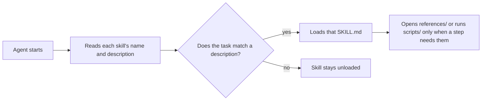

<p align="center">
  <picture>
    <source media="(prefers-color-scheme: dark)" srcset="docs/assets/banner-dark.svg">
    
  </picture>
</p>

<p align="center">
  <a href="https://github.com/teransarathchandra/agent-skills/actions/workflows/ci.yml"></a>
  <a href="https://github.com/teransarathchandra/agent-skills/releases"></a>
  <a href="LICENSE"></a>
  <a href="https://agentskills.io"></a>
  <a href="CONTRIBUTING.md"></a>
</p>

<p align="center">
  Plain Markdown skills that teach an AI coding agent one job, and the checks that stop it getting that job wrong.<br>
  They follow the open <a href="https://agentskills.io">Agent Skills</a> format, so they work in Claude Code and in any agent that reads <code>SKILL.md</code>.
</p>

<p align="center">
  <a href="#skills">Skills</a> ·
  <a href="#agentic-workflow-setup">Agentic setup</a> ·
  <a href="#install">Install</a> ·
  <a href="#use-it">Use it</a> ·
  <a href="#how-it-works">How it works</a> ·
  <a href="#development">Development</a> ·
  <a href="#contributing">Contributing</a>
</p>

## Why

An agent with no guidance will review a PR by skimming the diff, rewrite a CV with invented numbers, or paste a customer's name into a public file. These skills put the steps and the stop signs in writing, so the agent does the careful version every time:

- **Evidence first.** Findings and claims are checked against the real file, ticket or source before they are reported.
- **Private by default.** Skills that touch tickets, code or personal documents tell the agent not to copy names, emails, keys or quotes anywhere.
- **Stops before the point of no return.** Read-only unless you ask. Posting, pushing, submitting or publishing needs your word.
- **Short and plain.** Output reads like a teammate wrote it.

## Skills

| Skill | What it does | Try saying | Needs |
|---|---|---|---|
| [`pr-review-with-ticket-context`](skills/pr-review-with-ticket-context/SKILL.md) | Reviews a pull request against its Jira ticket. Finds the real root cause, then returns two grids: comments on the files the PR changed, and gaps outside the PR | "Review PR 123 for ABC-456." | `git`, `gh`; best with the [Jira delivery MCP](https://github.com/teransarathchandra/jira-mcp-server) |
| [`sanitize-skill-for-public`](skills/sanitize-skill-for-public/SKILL.md) | Turns a skill, prompt or notes written for private or work use into a fictional, public-safe copy and proves it is clean with a scan. Prepares only; never publishes | "Make this skill safe to publish." | Python 3.9+ for the bundled scanner |
| [`job-application-assistant`](skills/job-application-assistant/SKILL.md) | Asks what it needs as quick choices (reply `ok` for the recommended answers, or type your own), builds an ATS-safe CV from your real evidence (work tickets, or your GitHub pull requests and reviews when there is no Jira) and checks it with a parser-style script, tailors it to each ad's keywords, writes one cover letter per job, flags scam ads, helps you pick job sites and set up accounts, fills in employer application forms with a browser agent and preps STAR interview stories. Always stops before Submit | "Rebuild my CV for ATS and write a cover letter for this ad." | Python 3.9+ for the ATS checker; a .docx tool (Node.js 18+ and the `docx` package for the bundled letter script); a browser tool such as the Playwright MCP |

Each skill folder holds a `SKILL.md`, plus `references/` (longer guides and worked examples), `scripts/` and `assets/` where it needs them. Every example in this repository is fictional.

## Agentic workflow setup

A complete Claude Code setup for building any project the agentic way: a spec, a check Claude must pass, and the right toolkit per project type, loaded only where it is needed so sessions stay cheap. Paste this into Claude Code:

```text
Set up https://github.com/teransarathchandra/agent-skills for me by following its SETUP.md.
```

The agent clones the repo, asks which profile you want, shows a dry run and installs after you say yes. Or run it yourself:

```bash
git clone https://github.com/teransarathchandra/agent-skills ~/agent-skills
bash ~/agent-skills/setup/install.sh --profile recommended --dry-run   # then again with --yes
```

| Part | What you get |
|---|---|
| Core | `/kickoff <idea>` (interview, `SPEC.md`, scaffold, verify script, Stop hook, the right kit), `/commit-push-pr`, the `Explore` (Haiku), `ac-reviewer` and `browser-qa` agents, a TypeScript check hook, token-saving routing rules |
| Mods | [`flowbar`](plugins/flowbar/README.md): spec progress, last verify result and running agents above the prompt, plus `/kit`. [`workbench`](plugins/workbench/README.md): context use and turn cost, plus a git and PR pane |
| 14 project kits | Web, mobile, API, AI apps, CLI and npm packages, desktop, browser and VS Code extensions, bots, automation, data and ML, games and 3D, video and docs, infra, Shopify and Stripe. Each has a `kit.json`, a `scripts/verify.sh` and a few commands; `/kickoff` installs one per project |
| Work kits | `freelance-kit` (client onboarding, briefs, status reports, handover, security and license review) and `builder-kit` (scaffold your own plugins and MCP servers) |

How to use it, with walkthroughs for a portfolio, a mobile app and a website: [docs/agentic-workflow.md](docs/agentic-workflow.md). Undo with `bash setup/uninstall.sh`.

## Install

**Claude Code** (a plugin that updates itself):

```text
/plugin marketplace add teransarathchandra/agent-skills
/plugin install teran-skills@teransarathchandra
```

Update later with `/plugin marketplace update teransarathchandra`.

**Other agents** (copies editable files into your project):

```bash
npx skills@latest add teransarathchandra/agent-skills
```

**By hand:** copy a folder from `skills/` into your agent's skills directory (`~/.claude/skills/` for Claude Code).

## Use it

Ask in plain words. The agent loads the skill from its description, so you do not need a command:

```text
Review PR 123 for ABC-456.
```

In Claude Code you can also run a skill by name: `/teran-skills:pr-review-with-ticket-context`.

## How it works

An agent does not read every skill in full. It reads only the name and description of each one, and loads more only when a task needs it, so unused skills cost almost nothing.



That is why every description here starts with **"Use when"**: it is the one line the agent uses to decide.

## Repository layout

```text
skills/<name>/SKILL.md        one skill per folder; the folder name equals the skill name
skills/<name>/references/     longer guides and worked examples a skill links to
skills/<name>/scripts/        helper scripts a skill runs
skills/<name>/assets/         templates a skill fills in
skills/<name>/evals/          scenarios and trigger prompts to re-run with an agent after a change
template/SKILL.md             copy this to start a new skill
scripts/validate_skills.py    the checks CI runs on every skill and manifest
tests/                        tests for the scripts
docs/                         guides and cover art
.claude-plugin/               Claude Code plugin and marketplace manifests
```

## Development

No dependencies to install. Python 3.9 or newer, and Node.js 18 or newer for the letter-script tests.

```bash
python scripts/validate_skills.py              # skills, manifests, README links (what CI runs)
python -W error -m unittest discover -s tests
node --test tests/*.test.js                    # build_letter.js; needs no npm install
claude plugin validate .                       # Claude Code's own manifest check
```

CI runs the first three on every push and pull request. A skill with an `evals/` folder also lists scenarios to run with an agent, with and without the skill, after you change it; see [docs/authoring-skills.md](docs/authoring-skills.md#evaluations). `main` is protected: changes go through a pull request with a passing check. Releases are tags (`vX.Y.Z`) that the release workflow turns into a GitHub release from the [CHANGELOG](CHANGELOG.md).

## Contributing

Ideas and fixes are welcome. Open a [skill idea](https://github.com/teransarathchandra/agent-skills/issues/new?template=new_skill.yml) or read [CONTRIBUTING.md](CONTRIBUTING.md) and [docs/authoring-skills.md](docs/authoring-skills.md) first. Please keep private data out of anything you submit; [`sanitize-skill-for-public`](skills/sanitize-skill-for-public/SKILL.md) exists for exactly that. Report security problems privately: see [SECURITY.md](SECURITY.md). Questions: see [SUPPORT.md](SUPPORT.md).

## Acknowledgements

Built on the open [Agent Skills specification](https://agentskills.io/specification). The repository layout was shaped by looking at [mattpocock/skills](https://github.com/mattpocock/skills) and [anthropics/skills](https://github.com/anthropics/skills).

## License

[MIT](LICENSE) © Teran Sarathchandra
