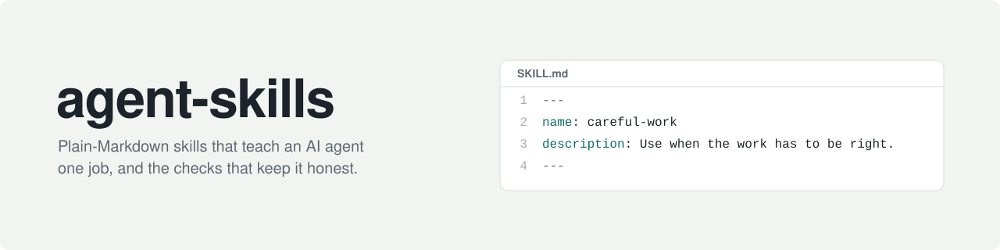
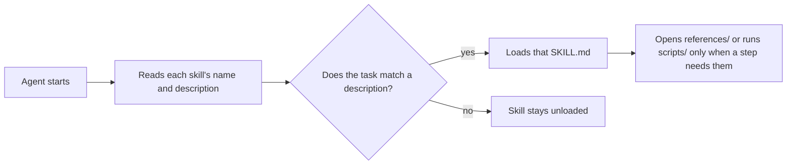
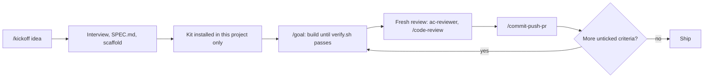

<p align="center">
  <picture>
    <source media="(prefers-color-scheme: dark)" srcset="docs/assets/banner-dark.svg">
    
  </picture>
</p>

<p align="center">
  <a href="https://github.com/teransarathchandra/agent-skills/actions/workflows/ci.yml"></a>
  <a href="https://github.com/teransarathchandra/agent-skills/releases"></a>
  <a href="LICENSE"></a>
  <a href="https://agentskills.io"></a>
  <a href="CONTRIBUTING.md"></a>
</p>

<p align="center">
  <b>Agent skills and a complete agentic workflow for Claude Code.</b><br>
  Skills that teach an AI agent one job and the checks that keep it honest,<br>
  plus a one-paste setup that gives every project a spec, a check Claude must pass and the right toolkit.
</p>

<p align="center">
  <a href="#quick-start">Quick start</a> ·
  <a href="#skills">Skills</a> ·
  <a href="#agentic-workflow">Agentic workflow</a> ·
  <a href="#faq">FAQ</a> ·
  <a href="#development">Development</a>
</p>

## What's inside

| | |
|---|---|
| **[Skills](#skills)** | Three plain-Markdown skills in the open [Agent Skills](https://agentskills.io) format: PR review with ticket context, public-safe sanitizing, and a job application assistant. They work in Claude Code and in any agent that reads `SKILL.md`. |
| **[Agentic workflow](#agentic-workflow)** | A Claude Code setup you install with one paste: `/kickoff` for any project, 14 project kits, two interface mods, freelance and builder kits, and token-saving defaults. |

## Quick start

### Set up the agentic workflow

Paste this into Claude Code:

```text
Set up https://github.com/teransarathchandra/agent-skills for me by following its SETUP.md.
```

Claude checks the prerequisites, asks which [profile](#profiles) you want, shows a dry run and installs only after you say yes. Restart Claude Code, then start your first project:

```text
/kickoff my developer portfolio
```

### Install only the skills

| Where | How |
|---|---|
| Claude Code | `/plugin marketplace add teransarathchandra/agent-skills`<br>`/plugin install teran-skills@teransarathchandra` |
| Any Agent Skills client | `npx skills@latest add teransarathchandra/agent-skills` |
| By hand | Copy a folder from `skills/` into your agent's skills folder (`~/.claude/skills/` for Claude Code) |

Update the Claude Code plugin later with `/plugin marketplace update teransarathchandra`.

## Skills

An agent with no guidance reviews a PR by skimming the diff, rewrites a CV with invented numbers, or pastes a customer's name into a public file. Each skill writes down the careful steps and the stop signs:

- **Evidence first.** Claims are checked against the real file, ticket or source before they are reported.
- **Private by default.** Names, emails, keys and quotes are never copied anywhere.
- **Stops before the point of no return.** Posting, pushing, submitting or publishing needs your word.
- **Short and plain.** Output reads like a teammate wrote it.

| Skill | What it does | Try saying |
|---|---|---|
| [`pr-review-with-ticket-context`](skills/pr-review-with-ticket-context/SKILL.md) | Reviews a pull request against its Jira ticket, finds the real root cause, and reports issues in the changed files and gaps outside the PR. | "Review PR 123 for ABC-456." |
| [`sanitize-skill-for-public`](skills/sanitize-skill-for-public/SKILL.md) | Turns a skill, prompt or notes written for private or work use into a fictional, public-safe copy, and proves it is clean with a scan. Never publishes. | "Make this skill safe to publish." |
| [`job-application-assistant`](skills/job-application-assistant/SKILL.md) | Builds an ATS-safe CV from your real evidence, tailors it and a cover letter to each ad, flags scam ads, and preps interview stories. Always stops before Submit. | "Rebuild my CV for ATS and write a cover letter for this ad." |

Ask in plain words: the agent loads a skill from its description, so no command is needed. In Claude Code you can also run one by name, for example `/teran-skills:pr-review-with-ticket-context`.

<details>
<summary><b>Requirements per skill</b></summary>

| Skill | Needs |
|---|---|
| `pr-review-with-ticket-context` | `git` and `gh`; works best with the [Jira delivery MCP](https://github.com/teransarathchandra/jira-mcp-server) |
| `sanitize-skill-for-public` | Python 3.9+ for the bundled scanner |
| `job-application-assistant` | Python 3.9+ for the ATS checker; Node.js 18+ and the `docx` package for the cover-letter script; a browser tool such as the Playwright MCP to fill in application forms |

The job application assistant asks what it needs as quick choices (reply `ok` to accept the recommended answers), can use your GitHub pull requests and reviews as evidence when you have no Jira, and helps you choose job sites and set up accounts. Each skill folder holds a `SKILL.md`, plus `references/`, `scripts/`, `assets/` and `evals/` where it needs them. Every example in this repository is fictional.

</details>

<details>
<summary><b>How skills load</b> (and why unused ones cost almost nothing)</summary>

An agent reads only the name and description of each skill, and loads the rest only when a task needs it.



That is why every description here starts with **"Use when"**: it is the one line the agent uses to decide.

</details>

## Agentic workflow

Chatting with an AI makes you the loop: you paste context, copy code out, run it and paste the errors back. This setup gives Claude the three things it cannot see on its own, so it can loop by itself:

| Claude gets | As | Enforced by |
|---|---|---|
| A **spec**: what "done" means | `SPEC.md` with checkbox acceptance criteria | `/kickoff` writes it with you |
| A **check**: a command that proves it | `scripts/verify.sh` | A Stop hook: Claude cannot finish while it fails |
| **Rules**: what must always or never happen | `CLAUDE.md` and hooks | Routing rules and the kit's hooks |

Every project then runs the same loop:



### What you get

- **`/kickoff <idea>`**: interviews you, writes `SPEC.md`, scaffolds the project, adds the verify script and Stop hook, and installs the right kit in that project only.
- **Agents**: `Explore` (codebase search on Haiku), `ac-reviewer` (fresh-context review against the spec) and `browser-qa` (Playwright checks on Sonnet).
- **Mods**: [`flowbar`](plugins/flowbar/README.md) shows spec progress, the last verify result and running agents above the prompt; [`workbench`](plugins/workbench/README.md) shows context use and turn cost, with a git and PR pane.
- **Kits**: [14 project kits](#kits), plus `freelance-kit` and `builder-kit`.
- **Defaults**: `/commit-push-pr`, a TypeScript check hook, token-saving routing rules, agent teams off and subagents on Sonnet.

### Profiles

| Profile | Installs |
|---|---|
| `minimal` | `/kickoff`, `/commit-push-pr`, the three agents, the check hook, routing rules and the two mods |
| `recommended` | Minimal, plus `freelance-kit`, `builder-kit` and the official `superpowers`, `frontend-design`, `playwright` and `typescript-lsp` plugins |
| `full` | Recommended, plus `plugin-dev`, `mcp-server-dev`, `agent-sdk-dev`, the `cc-safety-net` command guard and CLI tools (Ghostty, pnpm, gh, chezmoi, a status line) |

> [!NOTE]
> The installer backs up anything it replaces, only sets settings that are unset, and can be run again safely. `bash setup/uninstall.sh` removes what it created, restores what it replaced and keeps anything you edited.

<details>
<summary><b>Install without an agent</b></summary>

```bash
git clone https://github.com/teransarathchandra/agent-skills ~/agent-skills
bash ~/agent-skills/setup/install.sh --profile recommended --dry-run   # preview
bash ~/agent-skills/setup/install.sh --profile recommended --yes       # install
bash ~/agent-skills/setup/install.sh --check                           # verify; exits 1 if anything is missing
```

Add `--with-tools` to install the CLI tools with any profile. The step-by-step instructions an agent follows are in [SETUP.md](SETUP.md).

</details>

### Kits

`/kickoff` picks the kit that fits and installs it with `--scope project`, so its tools never load in unrelated sessions. Each kit has a `kit.json`, a `scripts/verify.sh` and a few commands, such as `/web-kit:visual-qa`.

| Kit | For |
|---|---|
| `web-kit` | Portfolios, websites and web apps (Astro, Next.js, shadcn, Vercel) |
| `mobile-kit` | Expo and native iOS apps, simulator tests with Maestro, store releases |
| `api-kit` | Backend APIs (Hono, Zod/OpenAPI, Drizzle, Postgres) |
| `ai-app-kit` | LLM features, RAG and agents, with evals first |
| `cli-kit` | CLI tools and npm packages |
| `desktop-kit` | Tauri and Electron apps, signing and notarization |
| `extension-kit` | Browser extensions (WXT) and VS Code extensions |
| `bot-kit` | Slack, Discord, Telegram and WhatsApp bots |
| `automation-kit` | Automation and scraping (Playwright, Crawlee) |
| `data-kit` | Analytics and ML in Python (uv, marimo, DuckDB) |
| `game-kit` | 2D and 3D web games, Godot, 3D assets |
| `media-kit` | Video (Remotion), slides (Slidev) and docs sites |
| `infra-kit` | Docker, Terraform, GitHub Actions, cloud CLIs |
| `commerce-kit` | Shopify apps and themes, Stripe payments |
| `freelance-kit` | Client onboarding, briefs, status reports and handover |
| `builder-kit` | Scaffolding your own plugins and MCP servers |

### Usage

```text
/kickoff my developer portfolio, using my CV and GitHub repos
/kickoff a habit tracker mobile app with streaks
/kickoff a Telegram bot that answers questions from our study notes
```

Inside a project, `/kit` shows its kit, plugins and `/goal` line, and `/workbench` opens the git and PR pane. The full guide, with walkthroughs for a portfolio, a mobile app and a website, is in [docs/agentic-workflow.md](docs/agentic-workflow.md).

## FAQ

<details>
<summary><b>Will it overwrite my Claude Code settings?</b></summary>

No. It adds its routing rules as a marked block in `~/.claude/CLAUDE.md`, sets two environment values only if you have not set them, and backs up any file it replaces to `~/.claude/backups/`. Run it with `--dry-run` first to see every change.

</details>

<details>
<summary><b>Does it make Claude use more tokens?</b></summary>

It is built to use fewer. Kits load only in the project that needs them, workflow commands cost nothing until you type them, search runs on Haiku and other subagents on Sonnet, and agent teams stay off. The workbench mod shows context use so you know when to `/clear`.

</details>

<details>
<summary><b>How do I undo it?</b></summary>

Run `bash setup/uninstall.sh` from the clone. It removes the files it created, restores the ones it replaced, keeps files you edited, removes the routing block and settings it added, and uninstalls its plugins. Add `--dry-run` to preview.

</details>

<details>
<summary><b>Does it work with agents other than Claude Code?</b></summary>

The skills do: they follow the open Agent Skills format. The agentic workflow (plugins, mods, hooks and `/kickoff`) is built on Claude Code features.

</details>

<details>
<summary><b>Is it safe to install?</b></summary>

Everything is plain, readable files. CI validates every plugin and scans for secrets, emails and personal paths, and the installer is tested against a throwaway home directory. Mods run unsandboxed as you, like any Claude Code mod, so read them first; both make no network calls of their own and never edit files.

</details>

## Development

No dependencies to install. You need Python 3.9 or newer, and Node.js 18 or newer for the letter-script tests.

```bash
python scripts/validate_skills.py              # skills, plugins, setup scripts, manifests, README links
python -W error -m unittest discover -s tests  # includes installer tests in a throwaway home directory
node --test tests/*.test.js                    # build_letter.js; needs no npm install
claude plugin validate . --strict              # Claude Code's own check of the marketplace and every plugin
bash setup/install.sh --no-plugins --dry-run   # see what the installer would change
```

CI runs the first four on every push and pull request. `main` is protected: changes go through a pull request with passing checks and resolved review threads. Releases are tags (`vX.Y.Z`) that the release workflow turns into a GitHub release from the [CHANGELOG](CHANGELOG.md). A skill with an `evals/` folder lists scenarios to re-run with an agent after a change; see [docs/authoring-skills.md](docs/authoring-skills.md#evaluations).

<details>
<summary><b>Repository layout</b></summary>

```text
skills/<name>/              one skill per folder: SKILL.md, references/, scripts/, assets/, evals/
template/SKILL.md           copy this to start a new skill
plugins/<name>/             the 14 project kits, freelance-kit, builder-kit, and the flowbar and workbench mods
setup/install.sh            the agentic workflow installer (uninstall.sh reverses it)
setup/claude/               core files it places in ~/.claude: /kickoff, agents, hook, routing rules
SETUP.md, AGENTS.md         instructions an AI agent follows to set this up or to change it
scripts/validate_skills.py  the checks CI runs
tests/                      tests for the scripts and the installer
docs/                       guides, including agentic-workflow.md, and cover art
.claude-plugin/             plugin and marketplace manifests
```

</details>

## Contributing

Ideas and fixes are welcome: open a [skill idea](https://github.com/teransarathchandra/agent-skills/issues/new?template=new_skill.yml), or read [CONTRIBUTING.md](CONTRIBUTING.md) and [docs/authoring-skills.md](docs/authoring-skills.md) first. Keep private data out of anything you submit; [`sanitize-skill-for-public`](skills/sanitize-skill-for-public/SKILL.md) exists for exactly that. Report security problems privately through [SECURITY.md](SECURITY.md), and ask questions through [SUPPORT.md](SUPPORT.md).

## Acknowledgements

Built on the open [Agent Skills specification](https://agentskills.io/specification). The repository layout was shaped by [mattpocock/skills](https://github.com/mattpocock/skills) and [anthropics/skills](https://github.com/anthropics/skills). The agentic workflow follows Anthropic's [Claude Code best practices](https://code.claude.com/docs/en/best-practices) and installs plugins from the [official marketplace](https://github.com/anthropics/claude-plugins-official), including [obra/superpowers](https://github.com/obra/superpowers).

## License

[MIT](LICENSE) © Teran Sarathchandra
